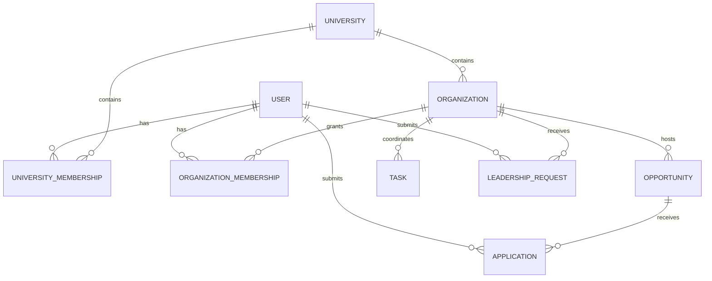

# CampusOps architecture

CampusOps serves university communities, beginning with an OAU product preview in Nigeria. OAU is configuration, not a special branch of application logic. The preview's clubs and records are sample content, not a representation of university operations or an affiliation claim.

Product rule: every feature must solve a concrete operational problem; every technical decision must improve maintainability, security, accessibility, or performance.

## One identity, several memberships

An account is a person, not an exclusive role. A student can lead multiple organizations and still apply to another organization's event under the same identity. `Account` has university memberships and organization memberships. The UI's `Profile.role` is a derived view of an authorized workspace; it is not a writable account attribute.

| Workspace                 | Required membership                                         | Scope                                                         |
| ------------------------- | ----------------------------------------------------------- | ------------------------------------------------------------- |
| My campus                 | Active university student                                   | Published campus opportunities, own applications and activity |
| Manage organization       | Active university membership plus active manager membership | One organization and its events, tasks, applications, reports |
| University administration | Invited university administrator                            | That university only                                          |

`resolveProfile()` denies contexts that do not match current memberships. `availableContexts()` generates navigation from those memberships. Changing workspace never grants access or changes the user's ID. Pending/revoked organization access and pending/suspended university membership do not authorize management. Anyone applying to their own organization's event needs another authorized reviewer; self-approval and self-rejection are both denied. Review activity records identify the affected student and the person who performed the action.

Personal and management navigation is deliberately separate to prevent mixing an organization's applicant queue with a student's private applications. In the local adapter, the selected workspace lives in session storage per tab; shared sample records live in local storage. Production should identify workspace scope in routes or equivalent request context, validated against the session on every request.

## Signup is a request, not a privilege grant

1. Capture name, email, university, and participation intent.
2. Create a pending student membership; validate email and university membership through the chosen backend workflow.
3. If leadership is requested, record a separate pending request. An invitation or authorized reviewer verifies the organization relationship.
4. Grant management access only after that separate verification. Keep the existing student identity and personal history.
5. University administrators are provisioned through trusted invitations. Public signup never offers an admin option or accepts a caller-supplied role.

The `/sign-up` screen currently **previews** these steps. It collects no password, sends no email, creates no account, and grants no access. Its result is ephemeral and cleared on reload. Account verification and invitation processing are intentionally deferred until a backend is selected.

## Boundaries in the implementation

| Module                               | Responsibility                                                                                   |
| ------------------------------------ | ------------------------------------------------------------------------------------------------ |
| `src/lib/access.ts`                  | Identity, university configuration, memberships, signup intent validation, context authorization |
| `src/lib/domain.ts`                  | Record types, tenant scoping, validation, state transitions, application rules                   |
| `src/lib/calendar.ts`                | Campus-local calendar dates and timezone-independent event instants                              |
| `src/lib/workspace-adapter.ts`       | Asynchronous adapter contract for data, commands, context selection, onboarding                  |
| `src/lib/demo-store.ts`              | Explicit browser preview adapter, local persistence, migration, recovery                         |
| `src/lib/preview/seed.ts`            | Sample records and test identities, isolated from domain policy                                  |
| `src/components/campus-provider.tsx` | Adapter integration, notifications, mutation progress, UI context                                |
| `src/features/*`                     | Independent route features, reusable tables and controls                                         |
| `src/components/dialogs.tsx`         | Editors loaded on demand, avoiding their full cost on initial render                             |

This is a modular monolith. Separate services would add coordination cost without solving a current product problem. Feature modules depend on shared domain policy and the adapter contract rather than database SDKs. The preview's in-memory commands are serialized by the UI; production must also implement database transactions and idempotency.

## University isolation

All organizations, opportunities, tasks, applications, and activity records carry `universityId`. Scope selectors and mutation checks enforce the current university even for an administrator. A changed resource ID or forged university field must not move a record across tenants.

When a database is connected:

- Store users, universities, university memberships, organization memberships, leadership requests, invitations, opportunities, tasks, applications, and audit events separately.
- Use composite foreign keys such as `(university_id, organization_id)` and `(university_id, opportunity_id)` to prevent cross-university relationships.
- Use unique memberships per user/university/role and user/organization/role as the approved policy permits; index tenant IDs with status, date, and ownership columns used by queries.
- Enforce active-application uniqueness and registration capacity transactionally. UI checks alone do not prevent concurrent double submissions or oversubscription.
- Derive the account from the authenticated server session. Do not accept a browser-supplied account, administrator role, or membership as authority.
- Scope database queries, exports, caches, jobs, uploads, and analytics by university and authorized organization. Cache keys also need user scope where records are personal.
- Return minimal page-specific data. Do not send every student's application to a browser and then filter it locally.

Universities define their name, country, locale, and IANA timezone. OAU uses `Africa/Lagos`. Event inputs are interpreted in the university timezone rather than the visitor's device timezone. Database-backed events should persist UTC instants plus the source timezone; ambiguous daylight-saving times need an explicit product rule when supporting regions that use them.

## Security boundary and backend connection

**Current status:** a local product preview, not an authenticated production system. Browser storage is editable and the sample account is preprovisioned. The policy tests verify intended rules; they do not turn browser storage into a security boundary. The v1 demo migration preserves records but discards its editable role selection.

The production adapter must use a real identity provider and a server data-access layer. Server mutations must load fresh memberships, validate input, check tenant and ownership, enforce CSRF protection where applicable, and write an audit record. Protect sessions with appropriate secure cookie settings. Invitations require expiration, single use, recipient binding, and privileged issuance. Revocation must take effect on subsequent requests. Add rate limits, operational logs without secrets, recovery processes, and deployment-specific security headers once the backend and hosting environment are chosen.

These boundaries follow the Next.js recommendation to centralize authorization near data access and OWASP's guidance to deny access by default and validate permissions on every request. [Next.js authentication](https://nextjs.org/docs/app/guides/authentication), [OWASP authorization](https://cheatsheetseries.owasp.org/cheatsheets/Authorization_Cheat_Sheet.html).

## Accessibility and performance

The UI uses labelled forms, native modal dialogs, visible keyboard focus, semantic tables, explicit workspace state, responsive navigation, scroll-contained tables, and reduced-motion support. Automated checks cover WCAG 2/2.1 A and AA rules on the personal overview and signup screen. These checks supplement keyboard and responsive workflow tests; they are not a claim of complete accessibility conformance.

`useReportWebVitals` emits a local `campusops:web-vital` event with metric name, value, and rating only. No analytics service is contacted and no account or URL data is included. A future telemetry adapter can consume that event under a reviewed privacy policy.

Targets are LCP ≤ 2.5 seconds, INP ≤ 200 ms, and CLS ≤ 0.1 at the 75th percentile of real visits. A separate 350 KiB initial JavaScript transfer budget is checked in the production browser test. The test attaches a local baseline including environment, DOM timing, transferred JavaScript, and observed Web Vitals. Local desktop measurements are not a substitute for field data on Nigerian mobile networks. [Core Web Vitals](https://web.dev/articles/vitals).

Before launch, test representative devices and constrained network profiles, use server pagination for long lists, instrument API latency and errors, and collect field percentiles. No production performance SLA has been established by this preview.

## Next backend increment

Connect session authentication and verification first, then implement the adapter with university-scoped server queries and database access rules. Next add invitation/leadership approval, transactional application review, and audit storage. Finally validate cross-tenant isolation against the real database, session revocation, backup recovery, accessibility, and mobile-network performance before onboarding real student records.
